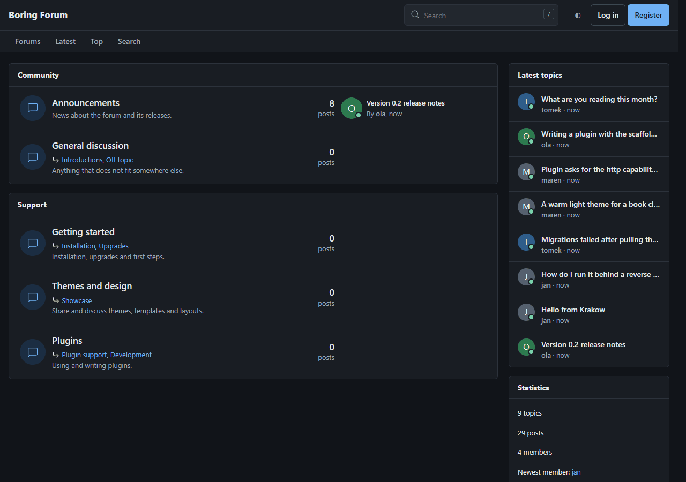
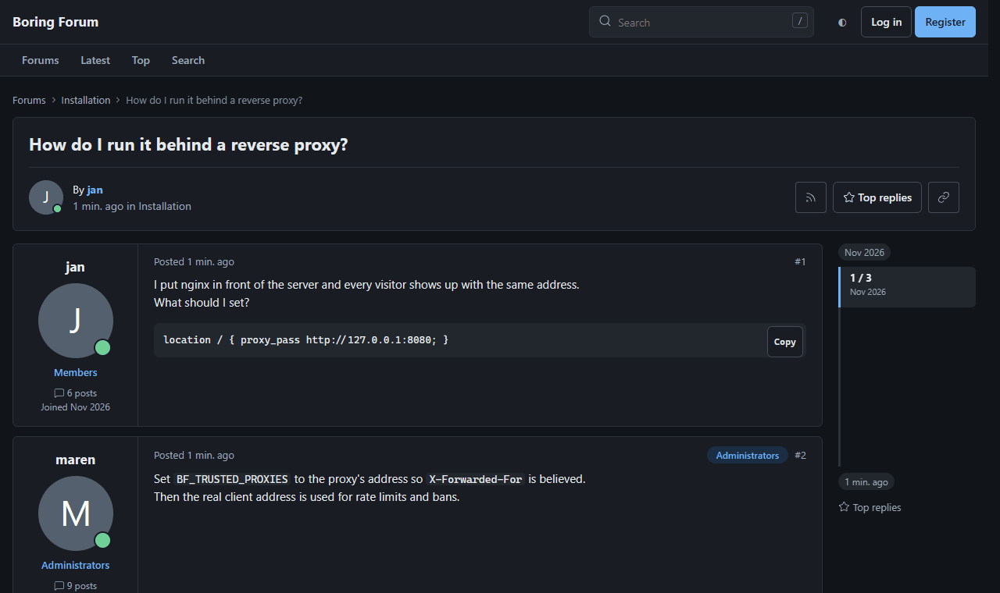
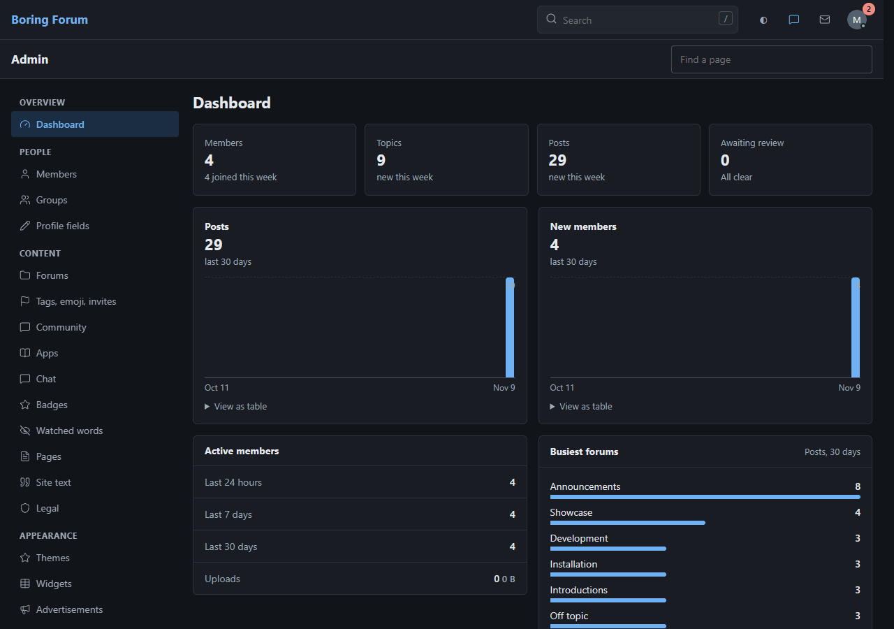
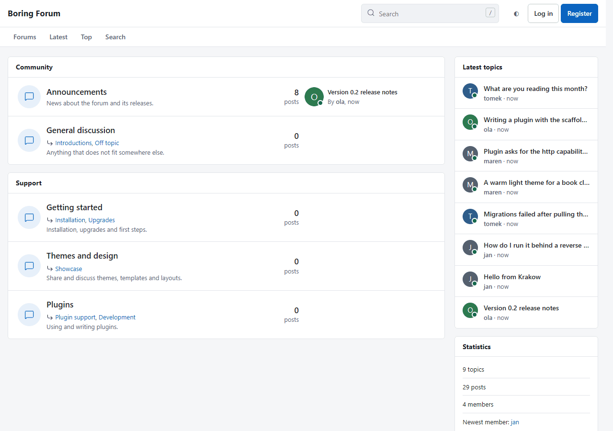
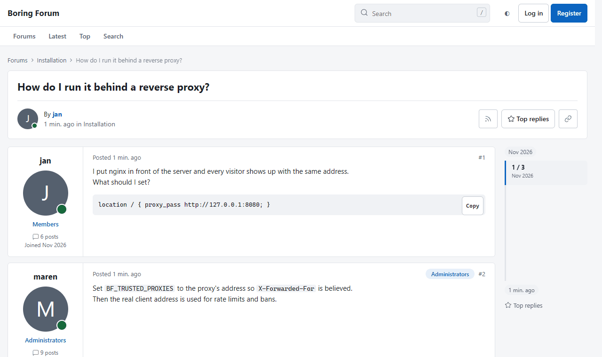
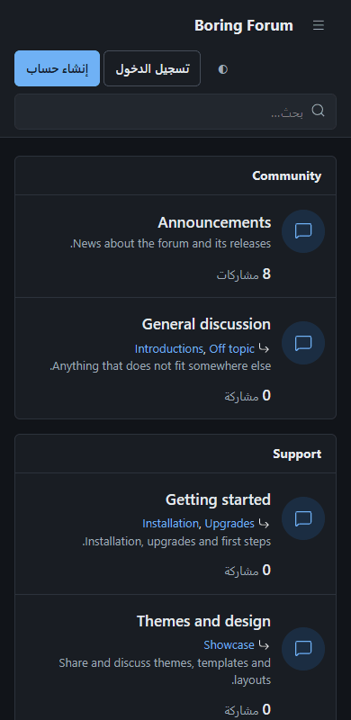

<div align="center">

# Boring Forum

**A fast, self-hosted community forum in a single binary.**

Categories, topics, groups, trust levels, moderation tools and an API, rendered as complete HTML
on the first response. Written in Rust and Svelte, with PostgreSQL for storage.

[](https://github.com/RikoDEV/boring-forum/actions/workflows/ci.yml)
[](https://github.com/RikoDEV/boring-forum/releases)
[](LICENSE)

[Quick start](#quick-start) · [Features](#features) · [Documentation](#documentation) · [Contributing](CONTRIBUTING.md) · [Security](SECURITY.md)

|  |  |  |
|---|---|---|
|  |  |  |

</div>

---

## Features

**Forums**
- Categories, forums and sub-forums with per-group permissions, inherited down the tree
- Topics in Markdown and BBCode with a live preview, drafts, quotes, uploads, syntax highlighting
  and oneboxes; edit history with diffs and revert
- Questions and answers, and ideas forums, with answers and votes
- Tags, bookmarks, reactions, polls, events, search, and RSS, Atom and JSON feeds

**People**
- Profiles and member cards, follows, groups, trust levels and badges
- Clubs, direct messages and chat
- Notifications in the app, by email, as digests and as web push
- English, Polish and Arabic (right to left), with administrator text overrides

**Moderation**
- Review queue, reports with auto-hide, bans and warnings, watched words and staff notes
- Upload scanning, spam tools and an append-only audit log
- EU Digital Services Act notices, statements of reasons and appeals

**Accounts and security**
- Passwords checked against known breaches, TOTP and backup codes, passkeys
- OAuth/OIDC sign-in and an OIDC provider, forced two-factor, session management
- Strict Content Security Policy, encryption of stored secrets and rate limiting
- An idempotent, ETag-aware JSON API with scoped keys and signed webhooks

**Platform**
- Page builder with widget areas, themes and colour schemes
- Plugins as sandboxed WebAssembly modules with approved capabilities
- Automation rules and a read-only Data Explorer
- Importers for IPS, phpBB, MyBB and Discourse
- ActivityPub federation (opt-in)

**Operations**
- One-file backups you can schedule, download by email link and restore from the admin panel
- Prometheus metrics, `/livez` and `/readyz`, and OpenTelemetry export
- Least-privilege database roles, a read-only container image and signed releases with SBOMs

## Quick start

1. Start the database and the server with Docker Compose (it pulls the release image; settings are
   read from the `.env` beside it, optional):

   ```sh
   mkdir forum && cd forum
   curl -fsSLO https://raw.githubusercontent.com/RikoDEV/boring-forum/main/deploy/compose.yml
   curl -fsSL https://raw.githubusercontent.com/RikoDEV/boring-forum/main/.env.production -o .env
   # edit .env first: BF_BASE_URL, and BF_SECRET_KEY from `docker compose run --rm server secret-key`
   docker compose up -d --wait
   ```

2. Open <http://127.0.0.1:8080> and register. **The first account on an empty database becomes the
   administrator.** The admin panel is at `/admin` and is shown to administrators only.

3. In the admin panel:
   1. **Settings**: set the site name, language and who may sign up.
   2. **Forums**: create your categories and forums, and set who may read and post.
   3. **Backups**: turn on automatic backups.

| Port | Service |
| --- | --- |
| 8080 | Web (HTTP, on `127.0.0.1` only until you put a reverse proxy in front) |
| 5432 | PostgreSQL (`127.0.0.1` only) |

All state lives in three volumes: the database, `/data/uploads` and `/data/backups`. The compose
database user is a Postgres superuser, which is fine for a trial and logs an error at start. For a
public site follow [Installing](docs/installation.md): a reverse proxy with TLS, email, a
`BF_SECRET_KEY` and the least-privilege database roles.

To run from source, with Rust and Node, see [Installing](docs/installation.md#without-docker).

## Documentation

| Guide | Contents |
| --- | --- |
| [Installing](docs/installation.md) | Docker or source, a reverse proxy and TLS, email, upgrading |
| [Administering](docs/administration.md) | Forums, groups and permissions, the admin panel section by section |
| [Moderating](docs/moderation.md) | The review queue, sanctions, spam protection, Digital Services Act process |
| [Configuration](docs/configuration.md) | Environment variables, encryption at rest, database roles, TLS |
| [Operations](docs/operations.md) | Monitoring, backups and restores, importing from another forum |
| [Features and settings](docs/features.md) | Uploads, federation, AI, themes, badges and more |
| [JSON API](docs/api.md) | API keys, request behaviour and webhooks |
| [Plugins](docs/plugins/getting-started.md) | Writing a plugin, and the [reference](docs/plugins/abi.md) |
| [Troubleshooting](docs/troubleshooting.md) | What to check when something is wrong |
| [Releasing](docs/releasing.md) | How versions are chosen and published, and how to roll back |

The same pages are published on the [wiki](https://github.com/RikoDEV/boring-forum/wiki).

## Architecture

| Part | Technology | Location |
| --- | --- | --- |
| Server, templates and API | Rust (Tokio, Axum, sqlx, askama) | [`crates/`](crates) |
| Interactive parts and admin panel | Svelte, SvelteKit | [`web/`](web) |
| Default theme | Layered CSS modules | [`themes/default`](themes/default) |
| Storage | PostgreSQL 18 | [`crates/bf-db`](crates/bf-db) |
| Tests | Rust, Vitest, curl suites, fuzzing | [`tests/`](tests), [`fuzz/`](fuzz) |

A request is rendered by the server as complete HTML and small Svelte islands add script where it
is needed. Guest pages that are safe to share come from a short-lived in-process cache.

## Contributing

Bug reports and pull requests are welcome; see [CONTRIBUTING.md](CONTRIBUTING.md). Please report
security issues privately as described in [SECURITY.md](SECURITY.md).

## License

Boring Forum is licensed under the [GNU Affero General Public License v3.0](LICENSE).
